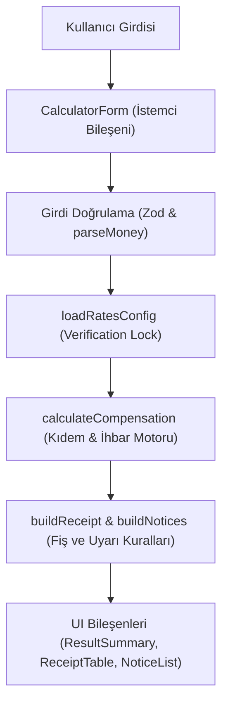

# Teknik Mimari ve Tasarım Kararları (MIMARI.md)

Bu doküman, **HakkımNe?** platformunun mimari yapısını, veri akışını, yasal hesaplama mantığını ve teknik tasarım kararlarını detaylandırır.

---

## 1. Veri Akışı ve Mimari Şema

Sistem, kullanıcı girdisinden ekrana kadar tek yönlü ve saf fonksiyonlardan oluşan deterministik bir veri akışına sahiptir:

---

## 2. Modül Sorumlulukları ve Bağımsızlık

- **`src/calculators/`:** Tamamen saf fonksiyonlar (pure functions). DOM veya React bağımlılığı yoktur. Girdi alır, yasal formülleri işletir ve sonuç nesnesi döner.
- **`src/receipt/`:** Hesaplanan tutarları adım adım fiş satırlarına (`ReceiptItem`) ve durum uyarılarına (`NoticeItem`) dönüştürür.
- **`src/config/`:** Yasal oranların (`rates.json`) ve site sabitlerinin yönetildiği tek merkezdir.
- **`src/utils/`:** Takvim süresi (`dateDuration`), para formatlama (`money`) ve doğrulama araçları.
- **`src/components/` ve `src/app/`:** Yalnızca sunum ve etkileşimden sorumlu arayüz katmanı.

---

## 3. Mimari ve Tasarım Kararları

### Neden Oranlar Kodun İçinde Değil? (`rates.json`)
Kıdem tavanı yılda iki kez (Ocak ve Temmuz), damga vergisi ve ihbar kademeleri ise yasal düzenlemelerle değişir. Hukuki parametreleri koddan ayırmak, güncelleme yaparken iş mantığına dokunma riskini sıfırlar ve CI/CD doğrulamasına (`check:rates`) imkan tanır.

### Neden Takvim ve UTC Mantığı?
Standart JavaScript `Date` nesnesi yerel saat dilimi (time zone) ve yaz saati uygulamaları (DST) nedeniyle gün kaymalarına sebep olur. Ayrıca artık yıllarda (leap year) 365 gün varsayımı hatalı sonuç üretir. Sistemde tarihler `YYYY-MM-DD` dizgisi olarak ele alınır, takvimsel yıl-ay-gün farkı saf matematiksel algoritmayla hesaplanır ve çıkış gününün çalışılmış sayılması (dahil edilmesi) kuralı işletilir.

### Yuvarlama Standardı
Finansal ve hukuki hesaplamalarda ara adımlarda (günlük brüt, yıl-ay-gün katsayıları) yuvarlama yapılmaz; float hassasiyeti korunur. Yalnızca kullanıcıya gösterilen nihai brüt, damga vergisi, gelir vergisi ve net tutarlar `Math.round((n + Number.EPSILON) * 100) / 100` formülüyle kuruşa yuvarlanır (`DECISIONS.md` Karar 3).

### Doğrulama Kilidi ve Test İzolasyonu
Canlı oran dosyasında (`rates.json`) `verified: false` olan tavanlar için sistem varsayılan değer uydurmaz, işlemi `blocked` statüsüne alır. Test ortamında ise bu kilit `tests/fixtures/rates.test.json` kullanılarak izole edilmiş; testlerin deterministik çalışması sağlanmıştır.

---

## 4. Bilinen Sınırlar ve Açık Doğrulamalar

- **İhbar Kademesinde 1,5 Yıl Eşiği:** 4857 sayılı İş Kanunu md. 17'de "6 aydan 1,5 yıla kadar" ifadesi yer alır. Sistemde 1 yıl 6 ay (tam 18 ay) dahil olarak 4 hafta, 18 ay 1 gün ve üzeri için 6 hafta uygulanır.
- **Kümülatif Gelir Vergisi Matrahı:** İhbar tazminatı gelir vergisine tabidir. Yıl içi kümülatif matrah bilinmediğinde başlangıç dilimi (%15) üzerinden tahmini hesaplama yapılır ve fişte kullanıcıya matrah uyarısı sunulur.

---

## 5. Mülakatta Anlat: 10 Teknik Not

1. **Statik & Sıfır Maliyet:** `output: 'export'` ile tamamen derleme anında üretilen statik mimari; Cloudflare Pages üzerinde sıfır sunucu maliyetiyle küresel ölçeklenme.
2. **Saf İstemci Mimarisi (KVKK By Design):** Maaş ve iş akdi gibi hassas veriler asla sunucuya gitmez; sıfır kişisel veri riski.
3. **Doğrulama Kilidi (Verification Lock):** Finansal/hukuki verilerde `verified: false` iken motorun çalışmasını engelleyen güvenli mimari.
4. **Takvim & Leap Year Hassasiyeti:** `Date` saat dilimi kaymalarına karşı saf takvimsel yıl/ay/gün çıkarma algoritması.
5. **Kuruş Hassasiyeti:** Ara adımlarda IEEE 754 float yuvarlama hatasını engelleyen ve yalnız nihai çıktıları yuvarlayan yapı.
6. **Modüler Pure Function Tasarımı:** Hesaplama motorunun UI katmanından tamamen bağımsız, React olmadan da test edilebilir olması.
7. **Kapsamlı Test Kapsamı:** 22 dosya, 247 test; sınır değer analizleri, senaryo testleri ve smoke testleri.
8. **Erişilebilirlik (WCAG AA):** Görünür odak halkaları, semantik landmark'lar ve ekran okuyucu uyumluluğu.
9. **Sıkı Tip Güvenliği:** TypeScript `strict: true` modu ve Zod doğrulama şemaları ile tip güvenli veri akışı.
10. **CI/CD Oran Doğrulama:** `npm run build:release` öncesi çalışan Node.js betiği ile güncelliği geçmiş tavanların yayına çıkmasını engelleyen otomatik kapı (gatekeeper).
